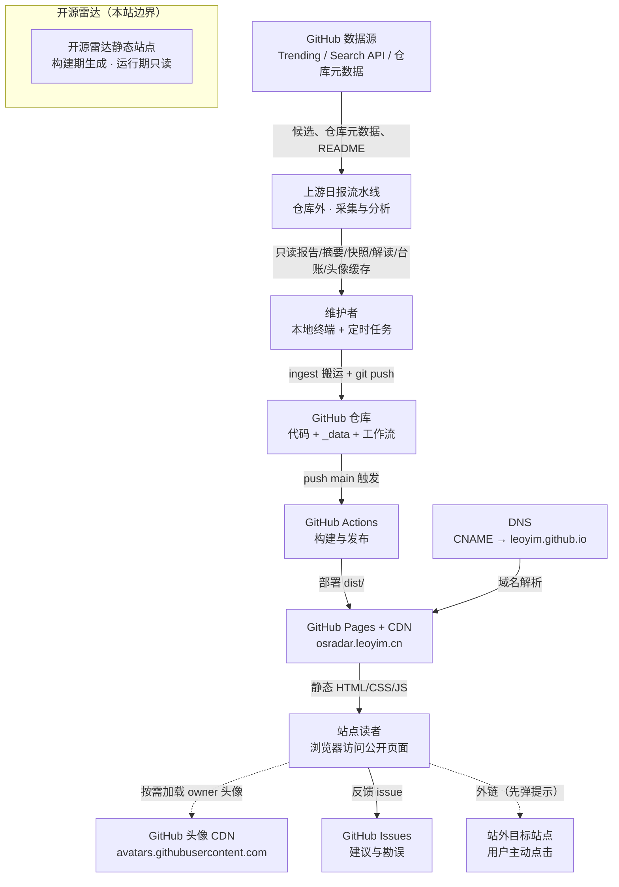

# 01 · 系统上下文（C4 L1）

> 视图问题：谁使用这个系统？系统边界在哪里？它依赖哪些外部系统，依赖的方向是什么？
> 规范源：[diagrams/architecture.structurizr.dsl](diagrams/architecture.structurizr.dsl) 的 `systemContext` 视图。

## 上下文图

## 参与者

| 参与者 | 目标 | 与系统的关系 | 证据 |
| --- | --- | --- | --- |
| 站点读者 | 读每日热点、查项目目录、看跨期统计与风险提示 | 匿名访问公开静态页面；不登录、不提交数据 | [README.md:48-57](../README.md#L48-L57) |
| 维护者 | 搬运新一期数据、修订本期观察、发布站点 | 在本地运行 ingest / sync / build，并推送到 `main` | [README.md:25-46](../README.md#L25-L46) |
| 上游日报流水线 | 每天产出可消费的数据快照 | 作为外部数据生产方；本站只读，不反向写入 | [README.md:9-23](../README.md#L9-L23) |

> 上游流水线是独立项目（本工作区外部的 `Github-Push-EveryDay` 目录），其采集、评分、筛查实现不在本文档的建模范围内；本文只把它当作一个“产出 JSON/Markdown 的外部系统”。

## 外部系统

| 外部系统 | 作用 | 交互方向 | 置信度 | 证据 |
| --- | --- | --- | --- | --- |
| 上游日报流水线 | 产出 `reports` / `summaries` / `snapshots` / `interpretations` / `blacklist` / `owners` | 上游 → 本地维护者（文件系统） | 高 | [tools/ingest.mjs:41-49](../tools/ingest.mjs#L41-L49) |
| GitHub 数据源 | 上游采集候选仓库、星标、README 等 | GitHub → 上游 | 高（README 声明） | [README.md:71-72](../README.md#L71-L72) |
| GitHub 仓库 | 托管源码、`_data/` 快照与 Actions 工作流 | 双向：维护者写入，Actions 读取 | 高 | [.github/workflows/pages.yml:3-5](../.github/workflows/pages.yml#L3-L5) |
| GitHub Actions | 安装依赖、构建、上传并部署 Pages | 仓库 → Actions → Pages | 高 | [.github/workflows/pages.yml:18-56](../.github/workflows/pages.yml#L18-L56) |
| GitHub Pages + CDN | 托管 `dist/`，绑定自定义域名 | Pages → 读者浏览器 | 高（配置）/ 中（CDN 行为） | [README.md:194-208](../README.md#L194-L208) |
| DNS | `osradar.leoyim.cn` 解析到 `leoyim.github.io` | DNS → 读者 | 中（文档声明，未在仓库内验证线上状态） | [README.md:202-206](../README.md#L202-L206) |
| GitHub 头像 CDN | 运行期按需加载 owner 头像 | 浏览器 → CDN | 高 | [README.md:90-97](../README.md#L90-L97)、[src/components/RepoRow.astro:93-113](../src/components/RepoRow.astro#L93-L113) |
| GitHub Issues | 接收建议与勘误 | 读者 → GitHub | 高 | [src/layouts/Base.astro:17-18](../src/layouts/Base.astro#L17-L18) |
| 站外目标站点 | 被收录项目的 GitHub 页面、主页等 | 读者主动点击；本站先弹提示 | 高 | [src/layouts/Base.astro:177-259](../src/layouts/Base.astro#L177-L259) |

## 系统边界

**在边界内**：

- 本仓库的源码、`_data/` 快照、`overrides/` 人工修订、`public/` 静态资源。
- `tools/` 下的搬运、台账回写、折扇模型生成脚本。
- Astro 构建过程与 `dist/` 产物。
- GitHub Actions 工作流定义。

**在边界外**：

- 上游流水线的采集、分类、评分、筛查逻辑。
- GitHub Trending / Search API 的可用性与配额。
- GitHub Pages 的 CDN、TLS、可用性。
- 读者浏览器对 WebGL、`<dialog>`、CSS 特性的支持。
- 站外页面内容与安全性。

## 关键边界规则

1. **只读上游**：`tools/ingest.mjs` 只从 `--source` 指向的目录读取，绝不写入上游；上游对本站完全无感知（[tools/ingest.mjs:1-17](../tools/ingest.mjs#L1-L17)）。
2. **CI 不采集**：工作流只执行 `npm ci` 与 `npm run build`，不运行 ingest；数据必须先提交进仓库（[.github/workflows/pages.yml:29-37](../.github/workflows/pages.yml#L29-L37)）。
3. **页面构建不发起业务网络请求**（依赖安装除外）：头像来自 `_data/owners.json` 离线缓存，农历由 `lunar-javascript` 本地推算，解读由本地 Markdown 渲染（[README.md:90-97](../README.md#L90-L97)、[README.md:159-163](../README.md#L159-L163)）。
4. **运行期无业务 API**：页面不请求本站后端；唯一第三方运行期请求是 owner 头像图片（浏览器直连 GitHub CDN），失败时回落到首字母徽记（[src/components/RepoRow.astro:96-113](../src/components/RepoRow.astro#L96-L113)）。
5. **外链不静默放行**：跨域 http(s) 链接先弹出原生 `<dialog>` 告知第三方风险；一次会话内只提示一次，修饰键点击直接放行（[src/layouts/Base.astro:177-259](../src/layouts/Base.astro#L177-L259)）。

## 信任边界

| 边界 | 说明 | 当前处理 |
| --- | --- | --- |
| 上游数据 → 本站 | 上游 JSON/Markdown 被视为可信内容 | `schema.ts` 只校验渲染依赖的字段形状，不校验业务真伪（[src/lib/schema.ts:155-185](../src/lib/schema.ts#L155-L185)） |
| 上游解读 Markdown → 页面 HTML | `marked` 渲染后用 `set:html` 注入 | 当前视为可信输入；未做 HTML sanitation（见待验证项） |
| 浏览器 → GitHub 头像 CDN | 第三方图片请求 | `referrerpolicy="no-referrer"`，加载失败移除 ``（[src/components/RepoRow.astro:103-112](../src/components/RepoRow.astro#L103-L112)） |
| 读者 → 站外链接 | 可能钓鱼或恶意页面 | 原生 `<dialog>` 提示，不构成背书（[src/layouts/Base.astro:94-108](../src/layouts/Base.astro#L94-L108)） |
| GitHub Actions → Pages | 发布权限 | 工作流声明最小权限：`contents: read`、`pages: write`、`id-token: write`（[.github/workflows/pages.yml:8-11](../.github/workflows/pages.yml#L8-L11)） |

## 假设与未知

- **假设**：上游日报流水线的数据产物格式就是 `schema.ts` 描述的形状；若上游演进，构建会失败而不是静默降级。
- **假设**：`_data/` 中的解读 Markdown 由受控流水线生成，可视为可信内容。
- **未知（低置信度）**：上游定时任务的具体调度器与运行环境；本文只知道它在本工作区外产出文件。
- **未知（低置信度）**：GitHub Pages 的实际 CDN 缓存策略、TLS 证书状态、DNS 解析状态；仓库内只有配置与文档声明。
- **未知（设计使然）**：站点没有任何访问统计、日志或运行时监控；这既是隐私承诺，也是可观测性缺口。

下一步：进入 [02-containers.md](02-containers.md) 查看构建期与运行期单元。