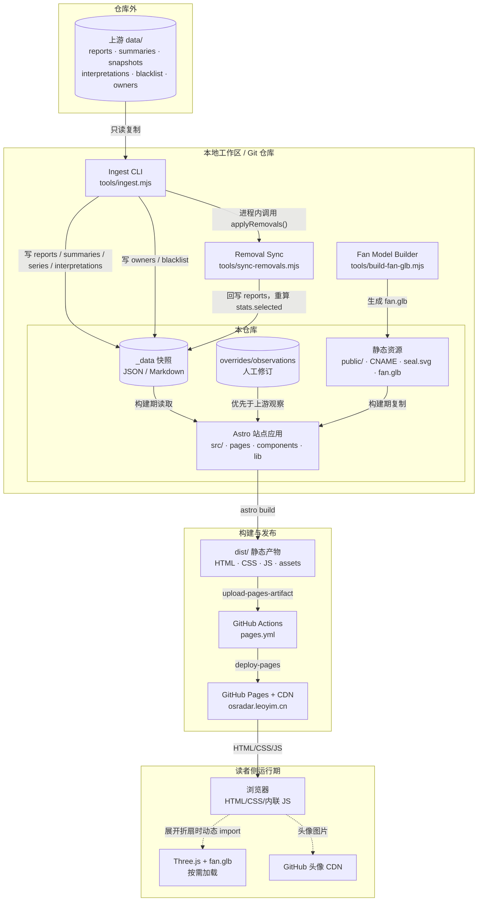

# 02 · 容器视图（C4 L2）

> 视图问题：系统由哪些可独立运行/构建/部署的单元组成？各自的技术选型、职责和状态是什么？
> 规范源：[diagrams/architecture.structurizr.dsl](diagrams/architecture.structurizr.dsl) 的 `container` 视图。

## 容器图

## 容器清单

| 容器 | 类型 | 职责 | 技术 | 运行时机 | 证据 |
| --- | --- | --- | --- | --- | --- |
| 上游 `data/` | 外部文件存储 | 提供报告、摘要、快照、解读、台账、头像缓存 | JSON / Markdown | 每天由上游流水线产出 | [tools/ingest.mjs:41-49](../tools/ingest.mjs#L41-L49) |
| `_data/` 快照 | 文件存储 | 本站唯一数据源，随 Git 提交，可重建全部历史 | JSON / Markdown | 构建期只读 | [src/lib/load.ts:6-15](../src/lib/load.ts#L6-L15) |
| `overrides/observations/` | 文件存储 | 人工修订“本期横向观察”，避免被下一次 ingest 覆盖 | Markdown | 构建期只读 | [src/lib/interpretations.ts:107-129](../src/lib/interpretations.ts#L107-L129) |
| Ingest CLI | 命令行工具 | 按日期/全量搬运上游；拼装星标序列；同步台账与头像；可选提交推送 | Node.js ESM | 维护者本地或定时任务 | [tools/ingest.mjs:235-296](../tools/ingest.mjs#L235-L296) |
| Removal Sync | 命令行工具 | 以台账为唯一准绳回写各期报告；`--check` 只检测 | Node.js ESM | ingest 进程内 / 手动 / CI | [tools/sync-removals.mjs:1-19](../tools/sync-removals.mjs#L1-L19) |
| Fan Model Builder | 命令行工具 | 生成十八骨折扇 GLB（几何与构件） | Node.js ESM | 手动 `npm run build:fan` | [tools/build-fan-glb.mjs:1-9](../tools/build-fan-glb.mjs#L1-L9) |
| Astro 站点应用 | 构建期应用 | 路由生成、数据读取、页面渲染、静态资源打包 | Astro 5.18 / TypeScript | `astro build` | [package.json:6-20](../package.json#L6-L20)、[astro.config.mjs:6-10](../astro.config.mjs#L6-L10) |
| `dist/` | 静态产物 | 可直接托管的 HTML/CSS/JS 与资源 | 静态文件 | 每次构建 | [.github/workflows/pages.yml:39-46](../.github/workflows/pages.yml#L39-L46) |
| GitHub Actions | CI/CD | 安装、构建、校验产物、上传并部署 Pages | GitHub Actions | push `main` / 手动触发 | [.github/workflows/pages.yml:1-56](../.github/workflows/pages.yml#L1-L56) |
| GitHub Pages + CDN | 托管 | 提供静态站点与自定义域名 | GitHub Pages | 持续 | [README.md:194-208](../README.md#L194-L208) |
| 浏览器运行时 | 客户端 | 渲染页面、筛选排序、主题/配色、解读浮层、折扇 3D | 原生 JS / `<dialog>` / WebGL | 读者访问时 | [src/layouts/Base.astro:110-260](../src/layouts/Base.astro#L110-L260) |

> 这里的“容器”不全是长期运行的服务。本站没有应用服务器、数据库或消息队列；三个 CLI 与 Astro 都是**构建期/数据面**单元，GitHub Pages 是唯一的运行期托管面。

## 页面路由与容器映射

| 路由 | 生成方式 | 主要组件 | 数据来源 |
| --- | --- | --- | --- |
| `/` | 最新一期 | `IssueView` | `listDates()[0]` + `loadIssue` |
| `/posts/<date>/` | `getStaticPaths()` 每期一页 | `IssueView` | 全部 `_data/reports/*.json` |
| `/projects/` | 第 1 页 | `ProjectsView` | `allProjects()` 跨期摊平 |
| `/projects/<page>/` | 第 2..N 页 | `ProjectsView` | 同上 |
| `/projects/lang/<slug>/` | 每种语言第 1 页 | `ProjectsView` | `langStats()` + `projectsOfLang()` |
| `/projects/lang/<slug>/<page>/` | 该语言第 2..N 页 | `ProjectsView` | 同上 |
| `/archive/` | 全期次 | `Base` + 目录行 | `loadAllIssues()` |
| `/stats/` | 跨期聚合 | `Base` + 6 张表 | `loadAllIssues()` + `publicBlacklist()` |
| `/removed/` | 风险提示 | `Base` + 证据链 | `loadBlacklist()` + `publicBlacklist()` |

路由定义见 [src/pages/](../src/pages/)；静态路径生成见 [src/pages/posts/[date].astro:6-12](../src/pages/posts/[date].astro#L6-L12)、[src/pages/projects/[page].astro:6-14](../src/pages/projects/[page].astro#L6-L14) 与 [src/pages/projects/lang/[lang]/[page].astro:7-16](../src/pages/projects/lang/[lang]/[page].astro#L7-L16)。

## 关键容器关系

1. **Ingest → `_data`**：报告与摘要按日期原样复制；星标序列不是复制，而是把上游 `snapshots` 与当期的 `stars/forks/rating/rank` 合并成逐日点列（[tools/ingest.mjs:123-151](../tools/ingest.mjs#L123-L151)）。
2. **Ingest → Removal Sync**：黑名单搬运完成后立即调用 `applyRemovals()`，保证“搬运完就回写”，上游已回写时是 no-op（[tools/ingest.mjs:270-282](../tools/ingest.mjs#L270-L282)）。
3. **Ingest → owners**：头像缓存与本地合并而不是覆盖，避免上游换机器或清缓存时丢掉历史头像（[tools/ingest.mjs:219-233](../tools/ingest.mjs#L219-L233)）。
4. **Astro → `dist`**：`output: 'static'`、`build.format: 'directory'`，生成目录式 URL（`/posts/2026-11-16/index.html`）；未注入 `SITE_URL` 时不输出 canonical / `og:url`（[astro.config.mjs:1-11](../astro.config.mjs#L1-L11)）。
5. **Actions → Pages**：构建作业与部署作业分离；部署前校验 `dist/CNAME` 与 `dist/index.html` 存在（[.github/workflows/pages.yml:18-56](../.github/workflows/pages.yml#L18-L56)）。
6. **Pages → 浏览器**：只返回静态资源；三维能力由浏览器按需拉取 `three` 与 `/models/fan.glb`（[src/scripts/fan3d.ts:204-221](../src/scripts/fan3d.ts#L204-L221)）。

## 容器级故障隔离

| 失败点 | 站点行为 | 证据 |
| --- | --- | --- |
| 上游某期报告缺失 | ingest 跳过该期并告警，不阻塞其他期 | [tools/ingest.mjs:107-113](../tools/ingest.mjs#L107-L113) |
| 上游摘要缺失 | 构建降级到报告原始描述，不报错 | [src/lib/load.ts:50-66](../src/lib/load.ts#L50-L66) |
| 上游解读缺失 | 该条目省略“详细解读”按钮，整节省略 | [README.md:99-108](../README.md#L99-L108) |
| 星标序列缺失 | 返回空数组，不渲染走势线 | [src/lib/load.ts:73-79](../src/lib/load.ts#L73-L79) |
| 头像缓存缺失/图片失败 | 回落首字母徽记，不出现破图 | [src/components/RepoRow.astro:93-113](../src/components/RepoRow.astro#L93-L113) |
| 台账缺失 | 返回空台账，相关页面为空但不崩 | [src/lib/load.ts:108-116](../src/lib/load.ts#L108-L116) |
| WebGL / 模型不可用 | 回退到 SVG 折扇，功能不减 | [src/scripts/fan3d.ts:1-7](../src/scripts/fan3d.ts#L1-L7) |
| 浏览器不支持 `showModal` | 外链提示退化为普通跳转 | [src/layouts/Base.astro:181-183](../src/layouts/Base.astro#L181-L183) |

下一步：进入 [03-components.md](03-components.md) 查看站点内部组件与模块依赖。