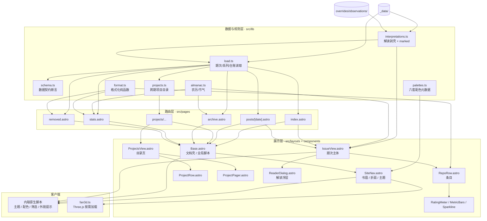

# 03 · 组件与模块（C4 L3）

> 视图问题：Astro 站点应用内部由哪些构建期组件组成？模块之间的依赖方向是什么？哪些规则必须守住？
> 规范源：[diagrams/architecture.structurizr.dsl](diagrams/architecture.structurizr.dsl) 的 `component staticApp` 视图；更细的导入关系见 [diagrams/module-dependencies.dot](diagrams/module-dependencies.dot)。

## 组件图

## 构建期组件

### 数据与规则层（`src/lib/`）

| 组件 | 职责 | 关键约束 | 证据 |
| --- | --- | --- | --- |
| `schema.ts` | 定义 `Issue` / `IssueItem` / `RemovalEntry` / `SeriesPoint` 等类型，并在构建期校验渲染依赖的字段 | 只校验真正影响渲染的字段；结构错误直接抛 `[数据契约]` | [src/lib/schema.ts:1-5](../src/lib/schema.ts#L1-L5)、[src/lib/schema.ts:146-190](../src/lib/schema.ts#L146-L190) |
| `load.ts` | 数据访问层：列期次、读报告并合并中文摘要、读星标序列、读台账、头像缓存、日期格式化与星期计算 | 只读 `_data/`；不联网；台账排序规则 `byLedgerPriority` 被两页共用 | [src/lib/load.ts:6-15](../src/lib/load.ts#L6-L15)、[src/lib/load.ts:118-141](../src/lib/load.ts#L118-L141) |
| `projects.ts` | 把每期条目按 `full_name` 摊平成跨期目录；语言 slug、分页、页首统计 | 同一仓库只保留最近一次记录并累计上榜次数；`PAGE_SIZE=24` | [src/lib/projects.ts:1-7](../src/lib/projects.ts#L1-L7)、[src/lib/projects.ts:45-107](../src/lib/projects.ts#L45-L107) |
| `interpretations.ts` | 读取上游解读 Markdown，剥掉 frontmatter、H1、指标表、署名，再用 `marked` 渲染；读取本期观察并优先使用本地覆盖 | 剥壳失败则原样保留，不猜测；渲染在构建期完成 | [src/lib/interpretations.ts:7-11](../src/lib/interpretations.ts#L7-L11)、[src/lib/interpretations.ts:31-55](../src/lib/interpretations.ts#L31-L55) |
| `almanac.ts` | 用 `lunar-javascript` 离线换算干支年、生肖、农历、节气与距下一节气天数 | 构建期执行，不进客户端产物；不调用黄历 API | [src/lib/almanac.ts:3-9](../src/lib/almanac.ts#L3-L9)、[src/lib/almanac.ts:30-52](../src/lib/almanac.ts#L30-L52) |
| `format.ts` | 数字、百分比、评分格、热度口径、角色名、移除锚点、sparkline 点列等纯函数 | 无副作用；移除锚点规则被 `/removed/` 与 `/stats/` 共用 | [src/lib/format.ts:1-54](../src/lib/format.ts#L1-L54) |
| `palettes.ts` | 六套中国风配色的展示元数据（名称、一字、副题、预览色） | `swatch`/`surface` 必须与 `global.css` 的 `--color-primary`/`--color-bg` 同步 | [src/lib/palettes.ts:1-31](../src/lib/palettes.ts#L1-L31) |

### 路由层（`src/pages/`）

| 路由组件 | 生成策略 | 关键点 | 证据 |
| --- | --- | --- | --- |
| `index.astro` | 单页 | 取 `listDates()[0]` 作为最新一期 | [src/pages/index.astro:6-15](../src/pages/index.astro#L6-L15) |
| `posts/[date].astro` | `getStaticPaths()` 每期一页 | 期次编号按总期数倒推 | [src/pages/posts/[date].astro:6-12](../src/pages/posts/[date].astro#L6-L12) |
| `projects/index.astro` + `projects/[page].astro` | 第 1 页 + 第 2..N 页 | 第 1 页只在 `/projects/`，避免同内容两个 URL | [src/pages/projects/[page].astro:6-14](../src/pages/projects/[page].astro#L6-L14) |
| `projects/lang/[lang]/index.astro` + `[page].astro` | 每种语言第 1 页 + 额外分页 | 只为条目数超过一页的语言生成第 2 页起 | [src/pages/projects/lang/[lang]/[page].astro:7-16](../src/pages/projects/lang/[lang]/[page].astro#L7-L16) |
| `archive.astro` | 单页 | 按年份分组，全部期次倒序 | [src/pages/archive.astro:1-18](../src/pages/archive.astro#L1-L18) |
| `stats.astro` | 单页 | 6 张跨期表：规模、评分、语言、涨星、常驻、台账索引 | [src/pages/stats.astro:15-70](../src/pages/stats.astro#L15-L70) |
| `removed.astro` | 单页 | 判定标准 → 批次说明 → 逐条证据链；条目不带外链 | [src/pages/removed.astro:11-45](../src/pages/removed.astro#L11-L45) |

### 展示层（`src/layouts/` + `src/components/`）

| 组件 | 职责 | 证据 |
| --- | --- | --- |
| `Base.astro` | 文档壳：head meta、首屏主题/配色内联脚本、跳转链接、页脚、外链提示、回到顶部、滚动进度 | [src/layouts/Base.astro:1-260](../src/layouts/Base.astro#L1-L260) |
| `SiteNav.astro` | 书眉导航、当前栏目、全屏折扇配色选择器、昼夜切换 | [src/components/SiteNav.astro:1-19](../src/components/SiteNav.astro#L1-L19)、[src/components/SiteNav.astro:238-260](../src/components/SiteNav.astro#L238-L260) |
| `IssueView.astro` | 期次封面、概览表、视角/方向筛选、分类条目、本期观察、上/下一期 | [src/components/IssueView.astro:1-61](../src/components/IssueView.astro#L1-L61) |
| `RepoRow.astro` | 单条仓库：标题、指标、摘要、主题、解读按钮、评分、走势、角色相关度、owner 头像 | [src/components/RepoRow.astro:1-117](../src/components/RepoRow.astro#L1-L117) |
| `ProjectsView.astro` | 项目目录页壳：语言筛选、列表、分页、页脚统计 | [src/components/ProjectsView.astro:1-88](../src/components/ProjectsView.astro#L1-L88) |
| `ProjectRow.astro` / `ProjectPager.astro` | 目录行与分页器 | [src/components/ProjectRow.astro](../src/components/ProjectRow.astro)、[src/components/ProjectPager.astro](../src/components/ProjectPager.astro) |
| `ReaderDialog.astro` | 原生 `<dialog>` 承载详细解读，`href="#read-<slug>"` 作为无 JS 兜底 | [src/components/ReaderDialog.astro:1-29](../src/components/ReaderDialog.astro#L1-L29) |
| `RatingMeter` / `MetricBars` / `Sparkline` | 评分格、四项指标条、星标走势 SVG | [src/components/RatingMeter.astro](../src/components/RatingMeter.astro)、[src/components/MetricBars.astro](../src/components/MetricBars.astro)、[src/components/Sparkline.astro](../src/components/Sparkline.astro) |

### 客户端交互层

| 组件 | 职责 | 加载方式 | 证据 |
| --- | --- | --- | --- |
| 首屏主题脚本 | 从 `localStorage` 或系统偏好设置 `data-theme`，并同步 `data-palette`，避免闪烁 | `<script is:inline>`，阻塞式 | [src/layouts/Base.astro:43-58](../src/layouts/Base.astro#L43-L58) |
| 全局交互脚本 | 昼夜切换、回到顶部、滚动进度、外链提示、配色切换 | `<script is:inline>` | [src/layouts/Base.astro:110-260](../src/layouts/Base.astro#L110-L260) |
| 期次筛选脚本 | 视角（角色）与方向筛选；重排 DOM；状态写入 URL，支持刷新/分享/前进后退 | Astro 打包脚本 | [src/components/IssueView.astro:294-400](../src/components/IssueView.astro#L294-L400) |
| 折扇启动脚本 | `
` 展开时启动 3D；合扇事件通知 3D 收拢 | Astro 打包脚本 | [src/components/SiteNav.astro:790-832](../src/components/SiteNav.astro#L790-L832) |
| `fan3d.ts` | 动态 `import('three')` 与 GLBLoader；自定义 GLSL；WebGL/模型失败返回 `null` | 按需动态导入 | [src/scripts/fan3d.ts:204-221](../src/scripts/fan3d.ts#L204-L221) |

## 模块依赖规则

1. **路由层不直接读文件**：页面通过 `src/lib/` 访问 `_data/`，而不是自己 `fs.readFile`；这样契约校验、缓存与排序规则只有一处。
2. **`schema.ts` 是叶子模块**：不依赖其他 `lib` 模块，避免契约层被业务逻辑污染。
3. **`load.ts` 不依赖页面/组件**：它只负责数据访问与展示无关的日期计算；`displayDate`/`weekdayOf` 是少量展示辅助。
4. **`projects.ts` 只依赖 `load.ts`**：跨期聚合不反向影响期次读取。
5. **`interpretations.ts` 只依赖 `load.ts` 的 `DATA_DIR` 与 `marked`**：渲染与数据路径解耦。
6. **组件通过 props 接收数据**：`IssueView` 接收 `Issue`，`RepoRow` 接收 `IssueItem`；只有 `RepoRow` 读取头像缓存与格式化函数。
7. **客户端脚本不 import 数据层**：浏览器侧只处理 DOM 与样式状态，不读取 `_data/`，避免把 Node API 打进客户端包。
8. **工具链单向**：`tools/ingest.mjs` → `tools/sync-removals.mjs`；`build-fan-glb.mjs` 独立，不依赖站点代码。

## 模块依赖图（DOT 源）

完整导入关系见 [diagrams/module-dependencies.dot](diagrams/module-dependencies.dot)。阅读要点：

- **页面 → 布局/组件 → lib** 是主方向；lib 不反向依赖页面。
- `IssueView` 是期次页的聚合点：向下组合 `RepoRow`/`ReaderDialog`，向上被 `/` 与 `/posts/<date>/` 复用。
- `ProjectsView` 被“全部项目”和“语言项目”两组路由复用，只有标题、筛选态与 `basePath` 不同。
- `SiteNav` 是唯一把配色元数据与 3D 脚本接起来的组件；`palettes.ts` 不依赖任何组件。
- `tools/` 与 `src/` 之间没有导入关系，只有通过 `_data/` 文件的契约耦合。

## 组件级注意事项

- `RepoRow` 的角色相关度进度条初始为 0%，由 `IssueView` 脚本按 `data-scores` 在客户端填充；无 JS 时条目仍可读，只是没有相关度百分比（[src/components/RepoRow.astro:86-92](../src/components/RepoRow.astro#L86-L92)、[src/components/IssueView.astro:318-326](../src/components/IssueView.astro#L318-L326)）。
- `ReaderDialog` 必须渲染在条目列表之外，否则 `<dialog>` 会被栅格项的层叠上下文困住；这是组件放置的硬约束（[src/components/ReaderDialog.astro:14-17](../src/components/ReaderDialog.astro#L14-L17)）。
- `palettes.ts` 与 `global.css` 是**双源同步**关系：新增配色需要同时改两处，文档在 [README.md:175-192](../README.md#L175-L192)。
- `fan3d.ts` 只做类型导入 `import type * as THREE_NS from 'three'`，运行时才动态 `import('three')`，因此 Three.js 不进入首屏包（[src/scripts/fan3d.ts:8](../src/scripts/fan3d.ts#L8)、[src/scripts/fan3d.ts:212-217](../src/scripts/fan3d.ts#L212-L217)）。

下一步：进入 [04-data-pipeline.md](04-data-pipeline.md) 查看数据从上游到页面的完整路径。