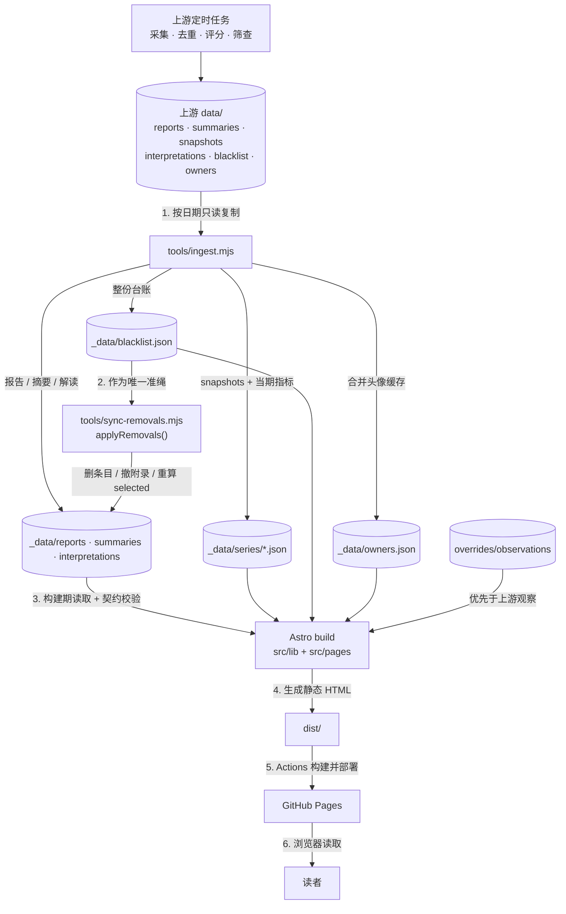

# 04 · 数据流水线

> 视图问题：一条数据从上游产物到读者页面，经过哪些步骤？每一步读写什么、用什么键关联、失败时会发生什么？
> 图源：[diagrams/data-pipeline.dot](diagrams/data-pipeline.dot)；文字中的行号指向具体实现。

## 端到端路径

## 上游产物与本地快照

| 上游路径 | 本地路径 | 搬运方式 | 用途 | 证据 |
| --- | --- | --- | --- | --- |
| `data/reports/<date>.json` | `_data/reports/<date>.json` | 按日期原样复制 | 每期榜单、分类、条目、统计、附录 | [tools/ingest.mjs:107-116](../tools/ingest.mjs#L107-L116) |
| `data/summaries/<date>.json` | `_data/summaries/<date>.json` | 原样复制 | 按 `full_name` 合并中文摘要与亮点 | [tools/ingest.mjs:117-121](../tools/ingest.mjs#L117-L121) |
| `data/snapshots/<date>.json` | `_data/series/<owner>__<repo>.json` | **派生**：快照 + 当期指标合并成逐日点列 | 星标走势 | [tools/ingest.mjs:98-103](../tools/ingest.mjs#L98-L103)、[tools/ingest.mjs:123-151](../tools/ingest.mjs#L123-L151) |
| `data/interpretations/<date>/*.md` | `_data/interpretations/<date>/*.md` | 原样复制 | 逐项详细解读；`index.md` 含本期观察 | [tools/ingest.mjs:153-159](../tools/ingest.mjs#L153-L159) |
| `data/owners.json` | `_data/owners.json` | **合并**（本地 + 上游，按键排序） | owner → 头像地址缓存 | [tools/ingest.mjs:219-233](../tools/ingest.mjs#L219-L233) |
| `data/blacklist.json` | `_data/blacklist.json` | 整份复制 | 移除台账，移除判定的唯一来源 | [tools/ingest.mjs:173-185](../tools/ingest.mjs#L173-L185) |
| 人工修订 | `overrides/observations/<date>.md` | 手工维护 | 覆盖“本期横向观察”正文 | [src/lib/interpretations.ts:107-129](../src/lib/interpretations.ts#L107-L129) |

## 数据对象与契约

### `_data/reports/<date>.json`（`Issue`）

| 字段 | 含义 | 构建期是否强校验 |
| --- | --- | --- |
| `date` | 期次日期 `YYYY-MM-DD` | 是 |
| `generatedAt` | 上游生成时间 | 否（类型声明） |
| `baseline` | 对比基线：`prevSnapshotDate`、`heatBasis` | 否 |
| `stats` | 候选、入选、拦截等计数 | 仅 `selected` 为 number |
| `categories[]` | 分类方向；每类有 `id`、`label`、`items[]` | 是（非空、id/label/items） |
| `categories[].items[]` | 条目：排名、仓库、星标、评分、热度、角色分、摘要等 | 是（`full_name`/`url`/`rating`/`stars`） |
| `suppressed[]` | 被 30 天窗口挡下的往期项目 | 否 |
| `removed[]` | 本期筛查附录；进台账后由回写工具撤下 | 否 |
| `watchlist[]` | 观察名单 | 否 |

类型与断言见 [src/lib/schema.ts:24-136](../src/lib/schema.ts#L24-L136)、[src/lib/schema.ts:155-185](../src/lib/schema.ts#L155-L185)。

### 其他数据对象

| 对象 | 形状 | 关联键 | 证据 |
| --- | --- | --- | --- |
| 摘要 `summaries/<date>.json` | `{ [full_name]: { summary_zh?, highlight_zh? } }` | `full_name` | [src/lib/load.ts:46-66](../src/lib/load.ts#L46-L66) |
| 星标序列 `series/<slug>.json` | `Array<{date, stars, forks?, rating?, rank?}>` | 文件名 `owner__repo` | [src/lib/load.ts:73-83](../src/lib/load.ts#L73-L83) |
| 详细解读 | 单个 Markdown；文件名 `<owner>__<name>.md` | `date` 目录 + `full_name` | [src/lib/interpretations.ts:76-90](../src/lib/interpretations.ts#L76-L90) |
| 头像缓存 | `{ [owner]: "https://avatars.githubusercontent.com/u/<id>" }` | `owner` | [src/lib/load.ts:90-101](../src/lib/load.ts#L90-L101) |
| 移除台账 | `{ meta, entries[] }`；条目含 `state`、`disclosure`、`category`、`issues[]`、`evidence[]`、`score` | `full_name` | [src/lib/schema.ts:64-116](../src/lib/schema.ts#L64-L116) |
| 本期观察覆盖 | 仅该节正文的 Markdown；文件头 HTML 注释会被剥掉 | `date` | [src/lib/interpretations.ts:117-128](../src/lib/interpretations.ts#L117-L128) |

## 标识与派生键

| 键 | 生成规则 | 用途 | 证据 |
| --- | --- | --- | --- |
| 期次键 | `YYYY-MM-DD` | 文件名、路由、排序 | [src/lib/load.ts:27-35](../src/lib/load.ts#L27-L35) |
| 项目键 | `full_name` = `owner/name` | 跨期去重、摘要合并、台账命中 | [src/lib/projects.ts:51-73](../src/lib/projects.ts#L51-L73) |
| 文件名 slug | `owner/name` → `owner__name` | 解读文件、星标序列文件、`#read-` 锚点 | [tools/ingest.mjs:105](../tools/ingest.mjs#L105)、[src/lib/load.ts:81-83](../src/lib/load.ts#L81-L83) |
| 移除锚点 | 小写、非字母数字转 `-`，去首尾 `-` | `/removed/#owner-repo` 深链 | [src/lib/format.ts:34-39](../src/lib/format.ts#L34-L39) |
| 语言 slug | 小写；`++`→`pp`、`#`→`sharp`、其余非字母数字→`-` | `/projects/lang/<slug>/` | [src/lib/projects.ts:32-41](../src/lib/projects.ts#L32-L41) |
| 系列键 | `full_name` → `owner__repo` | 走势文件读取 | [src/lib/load.ts:81-83](../src/lib/load.ts#L81-L83) |

## 每一步的读写与判定

### 1. 选择期次

- `--all`：上游 `data/reports/*.json` 全部；`--date`：指定一期；都不给：文件名排序后的最后一期（最新一期）。
- 上游报告不存在时跳过该期并告警，不影响其他期。
- 证据：[tools/ingest.mjs:245-268](../tools/ingest.mjs#L245-L268)。

### 2. 搬运报告、摘要、解读

- 报告与摘要直接复制；解读目录内所有 `.md` 复制到 `_data/interpretations/<date>/`。
- 所有写入都走 `writeIfChanged`：内容相同不落盘，因此重复执行是幂等的。
- 证据：[tools/ingest.mjs:115-159](../tools/ingest.mjs#L115-L159)、[tools/ingest.mjs:59-80](../tools/ingest.mjs#L59-L80)。

### 3. 拼装星标序列

对当期每个条目：

1. 读取已有 `_data/series/<slug>.json`，建立 `date → point` 映射；
2. 用上游 `snapshots` 中**不晚于当期**的星标数回填更早的历史点（不覆盖已有点）；
3. 写入当期点：`stars`、`forks`、`rating`、`rank`；
4. 按日期升序写回，只有内容变化才写盘。

证据：[tools/ingest.mjs:123-151](../tools/ingest.mjs#L123-L151)。

### 4. 同步台账并回写报告

`applyRemovals()` 以 `_data/blacklist.json` 为唯一准绳，遍历**全部**期次报告：

1. 从 `categories[].items` 删除 `full_name` 命中台账的条目；
2. 整类被清空时去掉空分类；全部清空时保留原结构，避免分类数组为空；
3. 从该期 `removed[]` 附录中撤下已进台账的条目——展示面统一交给 `/removed/`；
4. 重算 `stats.selected`，使其等于该期实际展示条目数；
5. 若台账 `issues[]` 未记录某期、但条目确实出现在该期，输出不一致提示，不静默处理；
6. 无命中不写盘；`--check` 只报告不修改，有漂移时退出码 1。

证据：[tools/sync-removals.mjs:51-123](../tools/sync-removals.mjs#L51-L123)、[tools/sync-removals.mjs:125-149](../tools/sync-removals.mjs#L125-L149)。

### 5. 合并头像缓存

- 读上游 `owners.json`，与本地 `owners.json` 合并：`{ ...local, ...upstream }`，按键排序后写回。
- 合并而不是覆盖，避免上游换机器或清缓存导致历史期次头像丢失。
- 证据：[tools/ingest.mjs:219-233](../tools/ingest.mjs#L219-L233)。

### 6. 可选提交推送

- `--push` 时 `git add -A`、`git commit -m "data: ingest <date>"`、`git push`。
- 推送失败只告警，不阻塞搬运：站点幂等，下次运行会补上。
- 证据：[tools/ingest.mjs:187-212](../tools/ingest.mjs#L187-L212)、[tools/ingest.mjs:290-292](../tools/ingest.mjs#L290-L292)。

### 7. 构建期读取与聚合

| 聚合 | 规则 | 证据 |
| --- | --- | --- |
| 摘要合并 | 按 `full_name` 把 `summary_zh`/`highlight_zh` 打到条目上；缺失则保留原描述 | [src/lib/load.ts:48-67](../src/lib/load.ts#L48-L67) |
| 跨期项目目录 | 最近一期优先；同仓库后续出现只累计 `times` 与 `dates` | [src/lib/projects.ts:48-80](../src/lib/projects.ts#L48-L80) |
| 语言分布 | 按 `language || '未标注'` 计数，按条目数倒序 | [src/lib/projects.ts:82-93](../src/lib/projects.ts#L82-L93) |
| 评分/语言/涨星/常驻 | 在 `stats.astro` 构建期聚合，不写回数据 | [src/pages/stats.astro:15-70](../src/pages/stats.astro#L15-L70) |
| 解读渲染 | 剥壳后用 `marked` 渲染成 HTML，构建期完成 | [src/lib/interpretations.ts:31-64](../src/lib/interpretations.ts#L31-L64) |
| 本期观察 | 本地覆盖优先，其次上游 `index.md` 的“本期横向观察”一节 | [src/lib/interpretations.ts:107-129](../src/lib/interpretations.ts#L107-L129) |
| 农历/节气 | 构建期用 `lunar-javascript` 推算并缓存 | [src/lib/almanac.ts:26-52](../src/lib/almanac.ts#L26-L52) |

## 不变量与失败模式

| 场景 | 期望行为 | 证据 |
| --- | --- | --- |
| `_data/reports/` 为空 | 直接抛错并提示先运行 ingest，不生成空站 | [src/lib/load.ts:27-30](../src/lib/load.ts#L27-L30) |
| 上游报告结构变化 | 构建失败，错误信息带字段路径 | [src/lib/schema.ts:146-150](../src/lib/schema.ts#L146-L150) |
| 重复搬运同一天 | 结果一致，不产生重复条目 | `writeIfChanged` + 文件覆盖 |
| 台账新增条目但上游未回溯 | sync 回写往期报告，撤下条目并重算入选数 | [tools/sync-removals.mjs:105-123](../tools/sync-removals.mjs#L105-L123) |
| 台账与报告不一致 | 输出 `mismatched` 提示，仍完成回写 | [tools/sync-removals.mjs:89-95](../tools/sync-removals.mjs#L89-L95)、[tools/sync-removals.mjs:139](../tools/sync-removals.mjs#L139) |
| 不公示条目 | 数据仍在台账中，但被 `publicBlacklist()` 过滤，不出现在页面与计数 | [src/lib/load.ts:131-141](../src/lib/load.ts#L131-L141) |
| 构建机时区为 UTC | 星期仍按日历计算，不会整体早一天 | [src/lib/load.ts:150-159](../src/lib/load.ts#L150-L159) |
| 头像缓存缺 owner | 返回 `null`，组件显示首字母徽记 | [src/lib/load.ts:90-101](../src/lib/load.ts#L90-L101) |

## 运行假设与限制

- **单写者假设**：ingest / sync 没有文件锁；同一时间应由一个进程写 `_data/`。当前使用方式是本地单维护者 + 定时任务，未观察到并发写入设计。
- **全量回写成本**：台账每次同步都遍历全部报告；期次数量增长后仍是线性成本，目前 23 期规模可接受。
- **解读全文内联**：一期约 30 篇解读全部写入同一张页面（约 150KB HTML），换取无 JS 也能读全文；这是有意的体积/可读性权衡（[README.md:210-217](../README.md#L210-L217)）。
- **上游可信**：解读 Markdown 经 `marked` 渲染后以 `set:html` 注入，未做 HTML sanitation；当前把上游视为可信输入（见 [01-system-context.md](01-system-context.md#信任边界)）。
- **历史深度**：星标走势依赖 `series/` 的逐日累积；早期期次没有更早的历史点，曲线会较短（[README.md:212](../README.md#L212)）。

下一步：进入 [05-deployment-and-runtime.md](05-deployment-and-runtime.md) 查看构建、发布与运行拓扑。