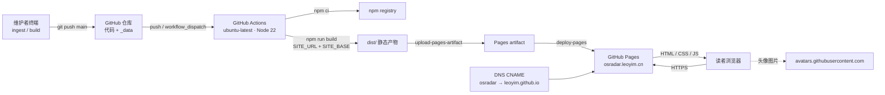
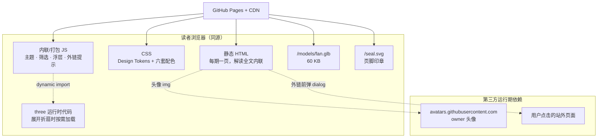

# 05 · 部署与运行拓扑

> 视图问题：在哪里构建、如何发布、运行期依赖什么、故障时退到哪里？
> 图源：[diagrams/deployment-release.dot](diagrams/deployment-release.dot)。

## 发布路径



## 构建配置

| 配置 | 值 | 影响 | 证据 |
| --- | --- | --- | --- |
| 输出模式 | `output: 'static'` | 无 SSR/API 路由，全部页面构建期生成 | [astro.config.mjs:6](../astro.config.mjs#L6) |
| URL 格式 | `build.format: 'directory'` | `/posts/<date>/` 对应 `index.html` 目录结构 | [astro.config.mjs:7](../astro.config.mjs#L7) |
| `site` | `SITE_URL` 环境变量，未设置时不输出 canonical/og:url | 本地构建不会带出占位域名 | [astro.config.mjs:8](../astro.config.mjs#L8) |
| `base` | `SITE_BASE`，默认 `/` | 自定义域名根路径部署 | [astro.config.mjs:9](../astro.config.mjs#L9) |
| 运行时框架 | 无 | 没有 React/Vue/Svelte hydration | [package.json:15-19](../package.json#L15-L19) |
| 主要依赖 | `astro`、`marked`、`lunar-javascript`、`three` | 三个构建期/按需依赖，一个运行时按需依赖 | [package.json:15-19](../package.json#L15-L19) |
| 本地 Node | v24.22.x（当前环境） | 与 CI 的 Node 22 存在版本差 | 环境信息 / [.github/workflows/pages.yml:26](../.github/workflows/pages.yml#L26) |

## CI/CD 工作流

`.github/workflows/pages.yml` 定义两个作业：

### build

1. `actions/checkout@v4` 检出仓库；
2. `actions/setup-node@v4`，Node 22，启用 npm 缓存；
3. `npm ci` 按 lockfile 安装；
4. `npm run build`，注入 `SITE_URL=https://osradar.leoyim.cn` 与 `SITE_BASE=/`；
5. 校验 `dist/CNAME` 与 `dist/index.html` 存在；
6. `actions/upload-pages-artifact@v3` 上传 `dist/`。

证据：[.github/workflows/pages.yml:18-46](../.github/workflows/pages.yml#L18-L46)。

### deploy

1. `needs: build`；
2. `environment: github-pages`；
3. `actions/deploy-pages@v4` 发布；
4. 输出 `page_url`。

证据：[.github/workflows/pages.yml:48-56](../.github/workflows/pages.yml#L48-L56)。

### 工作流级约束

- 触发：push 到 `main`，或手动 `workflow_dispatch`（[.github/workflows/pages.yml:3-5](../.github/workflows/pages.yml#L3-L5)）。
- 并发：`group: pages`，新推送取消排队中的旧任务（[.github/workflows/pages.yml:13-16](../.github/workflows/pages.yml#L13-L16)）。
- 权限：`contents: read`、`pages: write`、`id-token: write`，使用 OIDC 发布，不保存长期密钥（[.github/workflows/pages.yml:8-11](../.github/workflows/pages.yml#L8-L11)）。
- 数据采集不在 CI 内：工作流不运行 ingest，也不访问上游目录（[.github/workflows/pages.yml:29-37](../.github/workflows/pages.yml#L29-L37)）。

## 托管与域名

| 项 | 当前配置 | 证据 |
| --- | --- | --- |
| 托管 | GitHub Pages，Source 选择 GitHub Actions | [README.md:194-208](../README.md#L194-L208) |
| 域名 | `osradar.leoyim.cn` | [public/CNAME](../public/CNAME) |
| 根路径 | `base` 恒为 `/` | [astro.config.mjs:8-9](../astro.config.mjs#L8-L9) |
| DNS | `osradar` CNAME 到 `leoyim.github.io` | [README.md:204-206](../README.md#L204-L206) |
| HTTPS | 证书签发后在 Pages 设置中勾选 Enforce HTTPS | [README.md:206](../README.md#L206) |
| 备份/回滚 | 仓库历史可重建任意期；Pages 历史部署可用，但未文档化回滚步骤 | 推断（低置信度） |

## 运行期拓扑



### 页面交互（客户端）

| 能力 | 实现 | 无 JS / 降级 |
| --- | --- | --- |
| 明暗主题 | 首屏内联脚本设 `data-theme`；`localStorage.theme` | 默认跟随系统或浅色 |
| 六套配色 | `data-palette` + CSS tokens；`localStorage.palette` | 默认青瓷 |
| 视角/方向筛选 | 客户端重排 DOM；状态写入 `?role=&cat=` | 全部条目仍显示，只是不重排/不隐藏 |
| 详细解读 | 原生 `<dialog>` + `showModal()`；`href="#read-<slug>"` 兜底 | `.reader:target` CSS 打开浮层 |
| 外链提示 | 捕获跨域 http(s) 点击，弹 `<dialog>`；一次会话只提示一次 | `showModal` 不存在时退化为普通跳转 |
| 折扇 3D | 展开时动态加载 Three.js + GLB + GLSL | 回退到 SVG 折扇 |
| 回到顶部 / 滚动进度 | 内联脚本；`prefers-reduced-motion` 下瞬时跳转 | 无按钮时仍可滚动 |

证据：[src/layouts/Base.astro:43-58](../src/layouts/Base.astro#L43-L58)、[src/layouts/Base.astro:110-260](../src/layouts/Base.astro#L110-L260)、[src/components/SiteNav.astro:790-832](../src/components/SiteNav.astro#L790-L832)、[src/components/IssueView.astro:294-400](../src/components/IssueView.astro#L294-L400)、[src/scripts/fan3d.ts:204-221](../src/scripts/fan3d.ts#L204-L221)。

### 运行期存储与请求

| 项 | 使用 | 证据 |
| --- | --- | --- |
| `localStorage.theme` | 记住明暗 | [src/layouts/Base.astro:45-50](../src/layouts/Base.astro#L45-L50) |
| `localStorage.palette` | 记住配色 | [src/layouts/Base.astro:52-55](../src/layouts/Base.astro#L52-L55) |
| `sessionStorage['leave-ok']` | 一次会话内只提示一次外链 | [src/layouts/Base.astro:188-200](../src/layouts/Base.astro#L188-L200) |
| 同源静态资源 | HTML、CSS、JS、`fan.glb`、`seal.svg`、favicon | `public/` 与构建产物 |
| 第三方图片 | owner 头像 | [README.md:90-97](../README.md#L90-L97) |
| 本站 API | 无 | 静态输出，无服务端路由 |
| 分析/追踪 | 无 | 设计承诺，无相关脚本 |

## 可观测性与运维

**已有**：

- GitHub Actions 构建日志与部署历史。
- `tools/ingest.mjs` 的控制台摘要：每期入选数、报告/摘要/解读/序列变化、台账与头像同步结果。
- `tools/sync-removals.mjs --check`：台账漂移检测，退出码 1，可放进 CI。

**缺失 / 未知**：

- 没有站点访问统计、错误监控、可用性告警（隐私设计使然）。
- 没有运行时服务端日志（静态托管）。
- `pages.yml` **当前没有**执行 `npm run check:removals`，也没有 `astro check` / lint / 测试步骤；CI 只验证“能构建 + 关键产物存在”。
- 没有 PR 预览环境或独立 staging；本地 `astro dev` / `astro preview` 是唯一预发布手段。
- Pages CDN 缓存策略、TLS 续期、DNS 实际状态不在仓库内，属于平台侧行为。

## 发布前验证清单

```bash
# 1. 搬运与回写（本地，只读上游）
node tools/ingest.mjs --source <上游路径> --all

# 2. 台账漂移检测（不写盘，漂移时退出码 1）
npm run check:removals

# 3. 本地构建
npm run build

# 4. 产物自检
test -f dist/CNAME
test -f dist/index.html

# 5. 本地预览
npm run preview
```

证据：脚本定义见 [package.json:6-13](../package.json#L6-L13)；CI 产物校验见 [.github/workflows/pages.yml:39-42](../.github/workflows/pages.yml#L39-L42)。

## 运维风险与缺口（事实清单）

| 事实 | 影响 | 证据 |
| --- | --- | --- |
| 数据搬运不在 CI 内 | 忘记本地 ingest 会导致站点停在旧数据 | [.github/workflows/pages.yml:29-37](../.github/workflows/pages.yml#L29-L37) |
| CI 未跑 `check:removals` | 台账漂移可能直到人工发现才处理 | [README.md:39-46](../README.md#L39-L46)、工作流无该步骤 |
| 无访问监控 | 无法感知页面错误、资源 404、CDN 故障 | 设计承诺，无相关代码/配置 |
| 头像依赖第三方 CDN | 国内网络可能加载慢；失败已回落到首字母 | [README.md:90-97](../README.md#L90-L97) |
| 单页体积随解读数增长 | 一期约 150KB HTML；gzip 后较小，但增长需关注 | [README.md:215](../README.md#L215) |
| 本地 Node 24 / CI Node 22 | 可能存在未在 CI 覆盖的版本行为差异 | 环境信息 / [.github/workflows/pages.yml:26](../.github/workflows/pages.yml#L26) |

下一步：进入 [06-decisions-and-constraints.md](06-decisions-and-constraints.md) 查看关键决策与约束。