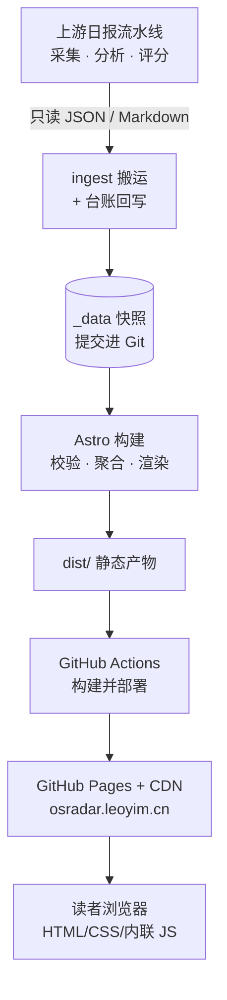

# 开源雷达 · 整体架构文档

> 对象：`github-opensource-radar`（https://osradar.leoyim.cn）
> 状态：当前态（current-state），基于 2026-11-16 的工作区快照
> 范围：系统边界、容器、构建期组件、数据流水线、发布与运行拓扑、关键决策与约束
> 证据：仓库代码、配置、GitHub Actions 工作流、README 与本地 `_data` 快照；上游流水线只按“外部系统”建模

## 一句话架构

**一个“文件即数据库”的静态发布系统**：仓库外的上游日报流水线负责采集与分析，本仓库用 `tools/ingest.mjs` 单向搬运快照到 `_data/`，Astro 在构建期完成校验、聚合与渲染，GitHub Actions 把纯静态产物发布到 GitHub Pages。

仓库原有的 [docs/architecture.jpg](../docs/architecture.jpg) 是流水线示意（WorkBuddy 定时采集 → Astro 渲染 → Actions 构建 → Pages 发布）；本文档把它展开为可验证的边界、容器、组件、数据与部署视图。

## 文档索引

| 文档 | 回答的问题 | 主要视图 |
| --- | --- | --- |
| [01-system-context.md](01-system-context.md) | 谁在用、系统边界在哪、依赖哪些外部系统 | C4 L1 系统上下文 |
| [02-containers.md](02-containers.md) | 有哪些构建期/运行期单元，各自职责与技术选型 | C4 L2 容器 |
| [03-components.md](03-components.md) | 站点内部如何分层，数据层、页面层、交互层如何协作 | C4 L3 组件 + 模块依赖 |
| [04-data-pipeline.md](04-data-pipeline.md) | 数据从上游到页面的完整路径、键与不变量、失败模式 | 数据流水线图 |
| [05-deployment-and-runtime.md](05-deployment-and-runtime.md) | 在哪里构建、如何发布、运行期发生什么 | 发布路径与运行拓扑 |
| [06-decisions-and-constraints.md](06-decisions-and-constraints.md) | 为什么这样设计，代价是什么，哪些边界不能破 | 决策记录与质量属性 |
| [system-model.evidence.md](system-model.evidence.md) | 每个节点/关系的证据、置信度与待验证项 | 证据索引 |
| [system-model.summary.md](system-model.summary.md) | 模型摘要、关键关系、假设与未知项 | C4 摘要 |

图源文件在 [diagrams/](diagrams/)：

- [architecture.structurizr.dsl](diagrams/architecture.structurizr.dsl)：C4 系统上下文、容器、组件视图的规范源，可用 Qoder 的 Structurizr DSL 查看器打开。
- [data-pipeline.dot](diagrams/data-pipeline.dot)：数据从上游到浏览器的 Graphviz DOT 源。
- [deployment-release.dot](diagrams/deployment-release.dot)：发布路径与运行期依赖的 DOT 源。
- [module-dependencies.dot](diagrams/module-dependencies.dot)：`src/` 与 `tools/` 的模块依赖 DOT 源。

> 文中 Mermaid 图是便于 Markdown 阅读的轻量视图；DOT 与 DSL 是更完整的可维护图源。当前环境未安装 Graphviz，DOT 未导出 SVG，可在任意 Graphviz 环境执行 `dot -Tsvg`。

## 规模快照

以下数字来自当前工作区的 `_data/` 与 `dist/`，用于说明量级，不是运行时承诺：

| 指标 | 数值 |
| --- | --- |
| 已归档期次 | 23 期（2026-10-23 至 2026-11-16） |
| 榜单条目 | 647 条（跨期去重后 647 个仓库） |
| 分类方向 | 6 个：`ai` / `backend` / `data` / `frontend` / `mobile` / `tools` |
| 语言 | 25 种标注语言，另有 7 条未标注 |
| 详细解读 | 618 个 Markdown（597 篇逐项解读 + 21 份 `index.md`） |
| 星标序列 | 661 个 `owner__repo.json` |
| 头像缓存 | 625 个 owner |
| 移除台账 | 88 条，其中公开 37 条 |
| 当前构建产物 | 99 个 HTML 页面 |
| `_data/` 体积 | 约 7.6 MB |
| `dist/` 体积 | 约 18 MB（未压缩，含全部解读全文） |

## 关键架构特征

1. **两段式生产**：采集与分析完全在仓库外的上游流水线完成；本站只负责搬运、校验、聚合、排版与发布。本站不写上游、不 import 上游代码（[README.md:9-23](../README.md#L9-L23)）。
2. **文件即数据库**：`_data/` 是可提交、可 diff、可回溯的文件快照，拿到仓库即可重建全部历史页面；没有运行时数据库。
3. **构建期做完一切**：契约校验、摘要合并、星标序列拼装、解读 Markdown 渲染、农历节气推算、跨期聚合都在 `astro build` 时完成；运行期没有 API 调用。
4. **运行期零框架**：页面是静态 HTML/CSS，交互用内联原生脚本；唯一较重的客户端依赖 Three.js 在打开折扇时按需动态加载，失败则回退到 SVG 折扇（[src/scripts/fan3d.ts:204-221](../src/scripts/fan3d.ts#L204-L221)）。
5. **单一准绳**：移除台账 `_data/blacklist.json` 是移除判定的唯一来源；`sync-removals.mjs` 负责把台账回写到各期报告并重算 `stats.selected`（[README.md:121-132](../README.md#L121-L132)）。
6. **失败要响**：上游数据契约在构建期逐字段校验，结构变化会让构建失败并指出路径，而不是渲染空白卡片（[src/lib/schema.ts:1-5](../src/lib/schema.ts#L1-L5)）。

## 核心不变量

| 不变量 | 保障方式 | 证据 |
| --- | --- | --- |
| 站点从不写入上游目录 | ingest 只读上游，仅写 `_data/` | [tools/ingest.mjs:1-17](../tools/ingest.mjs#L1-L17) |
| 搬运幂等 | `writeIfChanged`，内容相同不落盘 | [tools/ingest.mjs:59-80](../tools/ingest.mjs#L59-L80) |
| `stats.selected` 等于实际展示条目数 | 台账回写后按分类重新计数 | [tools/sync-removals.mjs:112-115](../tools/sync-removals.mjs#L112-L115) |
| 已进台账的项目不再出现在往期榜单 | 从 `categories[].items` 与 `removed[]` 中删除 | [tools/sync-removals.mjs:79-117](../tools/sync-removals.mjs#L79-L117) |
| 不公示条目不出现在任何页面与计数 | `publicBlacklist()` 双重过滤 | [src/lib/load.ts:131-141](../src/lib/load.ts#L131-L141) |
| 星期不随构建机时区漂移 | 用 `Date.UTC` + `getUTCDay()` 纯日历计算 | [src/lib/load.ts:150-159](../src/lib/load.ts#L150-L159) |
| 页面构建无业务网络请求 | 头像、农历、解读全部本地化（依赖安装除外） | [src/lib/almanac.ts:3-9](../src/lib/almanac.ts#L3-L9)、[README.md:90-97](../README.md#L90-L97) |

## 证据与置信度

- **高**：代码、配置、工作流、README、`_data/` 中的直接证据。
- **中**：多处信号一致但缺少单一直接来源，例如 GitHub Pages 的 CDN 缓存行为、上游流水线内部实现。
- **低 / 未知**：仅由命名或约定推断的内容，例如上游定时任务的具体调度器、DNS/证书的实际线上状态。

各项证据与置信度见 [system-model.evidence.md](system-model.evidence.md)；模型边界与待验证项见 [system-model.summary.md](system-model.summary.md)。

## 如何维护这份文档

- 数据契约变化时，先改 [src/lib/schema.ts](../src/lib/schema.ts)，再同步本文档的 L3 组件与数据流章节。
- 新增页面或路由时，更新 [02-containers.md](02-containers.md) 的路由表和 [diagrams/module-dependencies.dot](diagrams/module-dependencies.dot)。
- 发布方式变化时（例如换托管、加 CDN、加服务端能力），更新 [05-deployment-and-runtime.md](05-deployment-and-runtime.md) 与 `deployment-release.dot`。
- 文档中的规模数字应随 `_data/` 增长重新统计；不要把某一天的条目数写成架构不变量。